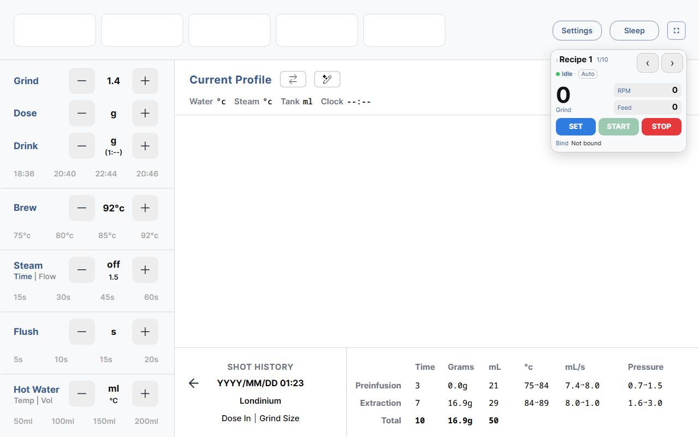

# CRYSTAL Grinder for Decaid

A [Decaid](https://github.com/decentespresso/decaid) plugin and skin that connect a **CRYSTAL
grinder** (ESP32-S3, BLE) and put its controls on the machine's screen next to the espresso
machine: grind setting, motor RPM, bean-feed gate, start mode and start/stop.



## Features

**Plugin**

- Connects over BLE to the CRYSTAL service `7fa2d10c-12f3-4b9e-9d77-1a9b65432100`, matching
  devices advertised as `CRYSTAL-xxxx`
- Publishes the grinder as a standard Decaid grinder: `startStop`, `grindSetting`, `rpmControl`
- Grind `0-1500`, RPM `0-1500`
- Vendor endpoints the host contract has no field for:
  - `GET|POST /api/v1/plugins/com.crystal.grinder/feed` - bean-feed gate `XD_RPM`, `0-150`
  - `POST /api/v1/plugins/com.crystal.grinder/start` - `{"mode":"manual"|"timer"|"auto"}` -> `BOOT_SIGN` 1/2/3
  - `GET /api/v1/plugins/com.crystal.grinder/status` - connection state and current values

**Skin** (`streamline-crystal`)

- The official streamline.js skin with a compact **floating panel** in the top-right corner
- Draggable; remembers its position
- 10 recipes: swipe left/right or use the arrow buttons to page
- Tap the large grind number to edit: 40 px nudge buttons, hold to repeat, per-field step sizes
- Shows grinder state from `SYS_STATE` (idle / grinding / offline)
- Follows the active espresso profile: recipes bound to a profile are selected and pushed
  automatically when the machine switches profile
- Grind value syncs to the skin's Grind tile and the active workflow
- English and Chinese, following the skin language; defaults to English

## Requirements

- **Decaid 0.9.1-beta.1 or newer** - the first release with the plugin BLE driver
  (`transport.ble`, `host.devices.bindDriver`)
- CRYSTAL grinder firmware exposing the service above (the `bleRPM` implementation)
- No pairing needed: the firmware does not enforce encrypted GATT access. If a future firmware
  does, the host needs a pairing call, which this plugin cannot provide.

## Install

**Plugin** - download `crystal-grinder-<version>.zip` from Releases, then:

```
Dashboard -> Plugins -> ... -> Install plugin -> ZIP file
```

**Skin** - download `streamline-crystal-<version>.zip` from Releases, then:

```
Settings -> Skins -> install -> pick the ZIP
```

Both install from a ZIP; the skin can also be installed from a URL.

## Usage

| Action | How |
|---|---|
| Open the editor | Tap the large grind number |
| Change recipe | Swipe the panel left/right, or tap the arrows (top-right) |
| Send values to the grinder | `SET` - hidden when "grind right after editing" is **Yes** |
| Start / stop | `START` / `STOP` |
| Move the panel | Drag the title row |

`START` stays locked after an edit until `SET` is pressed, unless the recipe is set to grind
right after editing.

## How it works

The grinder exposes six characteristics; every value is a big-endian `uint16`:

| Characteristic | UUID suffix | Direction |
|---|---|---|
| Motor RPM `MT_RPM` | `...0101` | read / write / notify |
| Bean feed `XD_RPM` | `...0102` | read / write / notify |
| Start item `BOOT_SIGN` | `...0103` | write: 1 manual, 2 timer, 3 auto, 4 stop, 5 apply grind |
| System state `SYS_STATE` | `...0104` | 0 idle, 1 grinding |
| Current grind `SERVO_ANGLE` | `...0105` | read / notify |
| Target grind `TF_ANGLE` | `...0106` | write, then `BOOT_SIGN = 5` |

Details and open questions are in [docs/PROTOCOL.md](docs/PROTOCOL.md); the REST/WebSocket
surface a skin can use is in [docs/INTERFACE.md](docs/INTERFACE.md).

## Repository layout

```
crystal-grinder.reaplugin/   plugin: manifest.json, plugin.js
skin/streamline-crystal/     skin: streamline.js fork + the CRYSTAL panel
  src/modules/crystal-grinder-panel.js
  src/css/crystal-grinder.css
docs/                        protocol, interface, install, publish, upload guide
test/                        protocol and manifest tests (Node, no Flutter needed)
build.ps1                    builds both zips into dist/
```

The skin is a two-line change to `index.html` plus two added files on top of streamline.js;
everything else is upstream code.

## Build and test

```powershell
# both zips -> dist/
./build.ps1

# 32 tests, no Flutter required
node test/run-all.mjs
```

## Data and settings

- Streamline's own settings ride in Decaid's KV store (`streamlineSettings`), so a new skin on
  the same machine inherits them automatically.
- The panel's recipes are mirrored to the `crystalGrinder` KV namespace: a fresh skin adopts
  them, while a skin that already has local recipes keeps (and republishes) its own.

## Troubleshooting

- **Plugin does not appear in Settings** - the plugin manager lives in the Dashboard, not in
  Settings: leave the skin (window icon or `Alt+Space` -> *Back to Dashboard*, or the system
  back gesture on Android) and open **Plugins** there.
- **Grinder not discovered** - check the grinder is powered and advertising as `CRYSTAL-xxxx`,
  then scan again from Devices. No pairing step is required.
- **START is greyed out** - the recipe has "grind right after editing" set to *No* and its
  values have not been sent yet: press `SET` first.
- **Blank skin after an update** - restart Decaid. The skin is served from a local port and the
  WebView caches modules aggressively; a restart reloads them.

## License

GPL-3.0-or-later. The skin is derived from
[allofmeng/streamline_project](https://github.com/allofmeng/streamline_project)
(Copyright (C) 2025-2026 Decent Espresso, GPL-3.0-or-later); its notice is kept in
`skin/streamline-crystal/LICENSE`.
