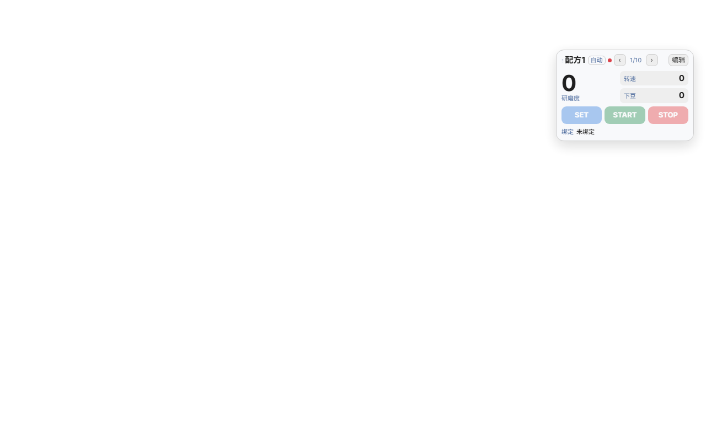

# CRYSTAL 磨豆机 × Decaid

CRYSTAL 磨豆机的 Decaid 插件、接口定义和控制皮肤。



## 目录

```
crystal-grinder/
  crystal-grinder.reaplugin/     插件包（安装这个）
    manifest.json                驱动声明、控制范围、设置项、厂商接口
    plugin.js                    BLE 协议实现
    README.md
  skin/
    streamline-crystal/          官方 streamline.js 的分支 + 磨豆机控制条（当前在用）
      index.html                 原皮肤，只多两行引用
      src/modules/crystal-grinder-panel.js   控制条 + 编辑弹窗
      src/css/crystal-grinder.css
      skin-manifest.json
    crystal-grinder-ui/          早期独立皮肤（保留作参考，未启用）
  docs/
    PUBLISH.md                   怎么发布给客户/要不要找官方/发布检查清单
    INSTALL.md                   Decaid 桌面版、插件、皮肤的安装位置与验证记录
    PROTOCOL.md                  BLE 协议实现口径 + 待确认问题
    INTERFACE.md                 给 skin 用的 REST / WS 接口
    screenshots/                 实机截图
  test/
    fake-host.mjs                假 GATT + 假插件宿主
    manifest.test.mjs            清单契约检查（7 条）
    plugin.test.mjs              协议行为测试（25 条）
    run-all.mjs                  一次跑全部
  build.ps1                      打包插件成 zip
```

## 为什么是「分支」而不是直接改官方皮肤

streamline.js 是从 GitHub 自动下载的（`isBundled: false`，带更新跟踪），直接改它会被下次
更新覆盖。所以复制成 `streamline-crystal`（id 独立、名字 "Streamline · CRYSTAL"），
官方文件一个没动。改动只有三处：

1. `index.html` 多一行 CSS、一行 `<script type="module">`；
2. 新增 `src/modules/crystal-grinder-panel.js`；
3. 新增 `src/css/crystal-grinder.css`。

## 浮动窗

一个可拖动的浮动卡片（默认右上角，位置会记住），约 250×160：

| 行 | 内容 |
|---|---|
| 1 | ⋮⋮ 配方名 · 1/10 ······ ‹ ›（右上角大按钮） |
| 2 | ● 空闲/研磨中/未连接 · 启动方式 |
| 3 | 研磨度（大字，点击进编辑）+ 转速 / 下豆（小字） |
| 4 | SET（按需隐藏）｜ START ｜ STOP |
| 5 | 绑定咖啡配方（按 ID 关联，只读显示名称） |

- 没有独立的「编辑」按钮：点研磨度那个大数字进编辑。
- 面板支持左右滑动翻配方（避开按钮和顶部拖动区），也可以点右上角的 ‹ ›。

- 状态取自蓝牙协议的 `SYS_STATE`：0 空闲、1 研磨中；未连接显示灰色。
- 配方里的研磨度会同步到左栏「Grind」磁贴（调用皮肤自己的 `updateGrindValue`）。
- 绑定列表直接读 `/api/v1/profiles`，选项值是 `profile:id`，显示 `profile.title`。
- 编辑弹窗：一行一个参数（标签 + 40px 的 −/+ + 数值 + 步距按钮），约 370px 高，1280×800 不用滚动；
  长按 −/+ 连加，步距 1/5/10/50 可切换；启动方式和即时研磨并排。
- 中英双语：默认英文，跟随皮肤语言（`localStorage.language` 与 `streamline:languagechange` 事件）；
  调试时可在 URL 上加 `?lang=zh` / `?lang=en` 强制切换。

窗口里不放加减号和滑条，所有数值都在「编辑」弹窗里改。

- 「调参完成即时研磨 = 是」：SET 隐藏，保存即下发，START 立即可用。
- 「调参完成即时研磨 = 否」：显示 SET，任何修改后 START 变灰，按过 SET 才解锁。

行为：

- 配方 10 组，存在皮肤自己的 localStorage（`crystal-recipes-v1`）；出厂默认研磨度 500、下豆 20、转速 800。
- `调参完成即时研磨 = 是`：改研磨度/转速/下豆立即下发；`否`：必须先按 SET 才下发，START 才解锁。
- STOP 走 `PUT /api/v1/grinder/state/idle`；START 走插件的 `POST …/start {mode}`（1/2/3）。
- 下豆档位走插件 `POST …/feed`（XD_RPM 0–150），Decaid 原生磨豆机接口没有这个字段。
- 绑定咖啡配方只做关联/显示（按你的选择），不会动咖啡机。
- 定时模式的时长由磨豆机自己决定，皮肤只发启动项 2。

## 跑测试

不需要 Flutter，用 Node（任意 18+）直接跑：

```powershell
node test/run-all.mjs
```

## 打包与发布

```powershell
.\build.ps1            # dist/ 下同时生成插件 zip 和皮肤 zip
```

发布流程、GitHub Release 规则、以及"要不要发给官方"见 [docs/PUBLISH.md](docs/PUBLISH.md)。

## 状态

- [x] 插件：BLE 协议、启停、研磨度、转速
- [x] 插件 0.2.0：`status` / `feed` / `start` 三个厂商接口
- [x] 单元测试（32 条全过）
- [x] 官方 streamline 皮肤分支 + 紧凑控制条（已设为默认皮肤）
- [x] 真机连通：扫描 → 连接 → 读状态 → 写转速（未配对）
- [ ] 真机 START/STOP、SET 下发（会动电机/舵机，等样机通电后验证）
- [ ] 配方与 Decaid 冲煮记录联动（现在只是本地存储）
